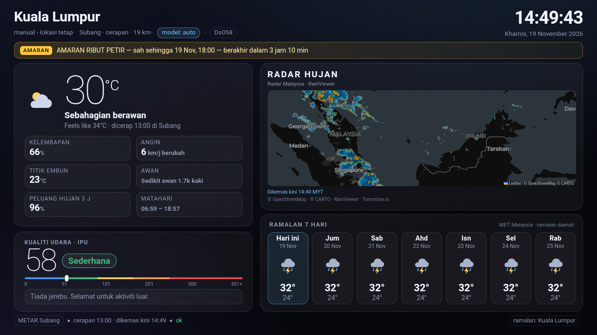

# TV Weather Dashboard

An always-on weather display for an Android TV box, built as a tiny fullscreen
kiosk app. It boots straight into the panel, recovers by itself, and needs no PC
once it is installed.



MET Malaysia district forecast and warnings, RainViewer radar, a 60-minute rain
outlook, air quality (IPU), current observations and a 7-day strip on one
1280x720 screen.

## What it needs

- **At runtime:** the TV and an internet connection. No PC, no server, no
  account to log into.
- **Keyless core:** MET Malaysia forecast/warnings, Open-Meteo, NOAA METAR,
  JAS/APIMS and RainViewer need no account at all.
- **Three free-tier keys, optional:** Tomorrow.io feeds the 60-minute rain
  outlook, OpenWeatherMap is a fallback current-conditions source, and CARTO
  serves the dark basemap tiles. All are read at build time from the
  environment or a git-ignored `keys.local.json`, proxied by the app shell, and
  never written into the page or the repository — see
  [API keys](#api-keys). Without them the dashboard still renders: the nowcast
  line, OWM fallback or CARTO tiles are simply skipped.
- **To build it:** a PC with Python and a JDK. No Android Studio, no Gradle.

## Where the data comes from

| Piece | Source | Notes |
|---|---|---|
| 7-day district forecast | **MET Malaysia** via `api.data.gov.my` | Official MET data, public, no key. 440 forecast locations. |
| Advisories / warnings | MET Malaysia via `api.data.gov.my` | Filtered to your state and the last 24 h. |
| Current conditions | **METAR** (NOAA) → Open-Meteo → OpenWeatherMap | A fresh airport observation (< 110 min) wins by default; see `CONFIG.preferObservation`. |
| 60-minute rain outlook | **Tomorrow.io** | 1-minute steps, proxied — the key never reaches the page. |
| Radar | **RainViewer** | Latest frame from `api.rainviewer.com`, proxied same-origin. |
| Basemap | **CARTO Dark Matter** → Esri → OSM | CARTO needs a free basemap key, proxied by the shell like the other keys; Esri/OSM are keyless fallbacks. |
| Location | ISP lookup → district match | `ip-api` first, `ipinfo` fallback, then nearest MET district. |

Observations come from `aviationweather.gov` (keyless). The old feed on
`metar.vatsim.net` is **simulated flight-sim weather** and is no longer used.
Both keyed sources are proxied through the shell, so no key appears in the page:
Tomorrow.io (`/api/nowcast`) and OpenWeatherMap (`/api/owm/current`,
`/api/owm/forecast`). `app.py` implements the same routes for local preview.

MET also runs its own API at `api.met.gov.my`, which hands out free tokens
(1,000 requests/day). It is supported — put the token in `CONFIG.metToken` and the
dashboard uses it instead of the public mirror. To get one, open
<https://api.met.gov.my/>, click **Login → Get Your Access Token**, and fill in the
form; approval is manual, so it is the one thing that cannot be automated.

The token is **optional**: `api.data.gov.my` already republishes MET's official
district forecast and warnings, so the dashboard shows MET's own BM text and
advisories without an account. The token only removes the mirror as a middleman.

## Location resolution

Order of preference (`CONFIG.manual` in `static/index.html`):

1. **Auto-detect GPS** — attempts browser geolocation (device GPS or network-based location).  
   On Android 6+ the user will be prompted to allow location access.  
   If granted, the nearest MET forecast district is used automatically.  
   If denied or unavailable, falls back to option 2.

2. **Manual** — for a fixed display, put your district and coordinates in
   `kiosk.local.json` (git-ignored); `tools/build_html.py` injects it into the
   page at build time:
   ```json
   { "manual": { "locationId": "Ds054", "lat": 3.0, "lon": 101.4,
                 "region": "Selangor", "note": "manual" } }
   ```
   The repository ships `manual: null`, so a fresh clone asks for GPS or falls
   back to ISP geolocation. This is the recommended setting for a fixed home;
   use it if you don't want the app to request location permission.

3. **ISP geolocation** — public IP → lat/lon → nearest MET forecast district  
   (277 of the 440 districts have coordinates, from geoBoundaries ADM2).  
   Useful when GPS is denied or the device has no GPS hardware.

4. **Fallback** — Klang (Ds054) if the network is unreachable.

Find ids in `data/locations.json`, or run `python tools/find_location.py kuala`.

## Layout

```
weather-tv/
  static/index.html        page + logic (config block at the top)
  static/style.css         stylesheet, inlined at build time
  data/locations.json      MET location id -> name/coords
  dist/index.html          built page (this is what ships in the APK)
  dist/weather-kiosk.apk   signed installable
  android/                 kiosk app sources
  app.py                   optional local preview server
  tools/                   build + device helper scripts
  .sdk/                    Android platform + build-tools (~130 MB, gitignore)
```

## Everyday commands

```powershell
# change the page, then ship it to the TV (no APK rebuild, ~2 s)
python tools\build_html.py
powershell -ExecutionPolicy Bypass -File .\scripts\update-page.ps1

# rebuild the APK (only needed when android/ changes)
python tools\build_apk.py
powershell -ExecutionPolicy Bypass -File .\scripts\install.ps1

# preview on this PC
python app.py            # http://localhost:8080

# remove everything from the TV
powershell -ExecutionPolicy Bypass -File .\scripts\uninstall.ps1
```

(The `-ExecutionPolicy Bypass` flag is only needed if your shell blocks local
scripts. `adb` is expected at `C:\platform-tools\adb.exe`; override with `-Adb`.
The device address is deliberately not stored: pass `-Device <ip:5555>` or set
`$env:KIOSK_DEVICE` — `tools/smoke.py` reads the same variable.)

## How the kiosk works

- `MainActivity` hosts a `WebView` at a fake origin `http://weather.local/`;
  `shouldInterceptRequest` answers it from device storage, so the page is not
  loaded from the network but still counts as a normal web origin (CORS works).
- The HTML is read from `/sdcard/Android/data/tv.weather.kiosk/files/index.html`
  when present, otherwise from the packaged asset — that is why page updates are
  instant while the app stays installed.
- **Known-good fallback.** The page is read in the order `index.html` →
  `index.html.bak` → packaged asset. `scripts/update-page.ps1` copies the running
  page to `index.html.bak` before every push and verifies the byte count. If the
  new copy never sends its first heartbeat within 90 s, the shell records its
  fingerprint in `SharedPreferences`, marks it unbootable and immediately reloads
  from the backup — so a broken push costs about 90 s, once, instead of a dark
  lobby. Pushing a new file changes the fingerprint and re-enables the primary
  copy automatically.

## Radar

The radar card is a **Leaflet 1.9.4** map (`static/vendor/leaflet.js`, inlined by
`tools/build_html.py`) showing **RainViewer** precipitation tiles over a CARTO
Dark Matter basemap. It is non-interactive (no drag/zoom/keyboard) for lobby use.

| Piece | URL | Notes |
| --- | --- | --- |
| Frames | `api.rainviewer.com/public/weather-maps.json` | latest `radar.past[-1]` |
| Tiles | `tilecache.rainviewer.com<path>/256/{z}/{x}/{y}/2/1_1.png` | colour 2, smoothed |
| Basemap | `{s}.basemaps.cartocdn.com/dark_nolabels` and `dark_only_labels`, `…?key=…` | CARTO key; `?key=` is the only working param |
| Fallbacks | Esri Dark Gray Canvas → OSM (CSS-darkened) | keyless, after 3 `tileerror` |

Both the frame list and the tiles are served **same-origin** by
`/api/rainviewer/maps` and `/api/rainviewer/tile?f=&z=&x=&y=` (`app.py` and
`MainActivity.serveRainviewer`), so the page fetches nothing cross-origin and the
frame path is validated as `/v2/radar/<id>`.

`CONFIG.radarRegion` picks the initial view: `my` z5, `sem` z6, `east` z6. The
stamp shows the **frame's** time, and the frame only advances when a newer one is
published, so the label always matches what is on screen. On failure the previous
frame stays up; the card hides only if nothing ever loaded.

Under the map, `renderNowcast()` adds a one-line outlook from Tomorrow.io
(`/api/nowcast`): `tiada hujan 60 min`, `hujan ±12 min lagi`, `berhenti ±20 min`
or `hujan berterusan`. It ignores steps under 0.25 mm/h (or under 0.1 mm/h with
< 50% probability) — otherwise a 0.12 mm/h drizzle 54 minutes out gets announced
as rain and the display looks broken. The free tier allows 25 calls/hour (the
kiosk uses 6), so a failed refresh keeps the previous line and only drops it
after 20 minutes.

The legacy MET CAPPI GIF proxy (`/api/radar/<region>`, `/api/radar/<region>/meta`,
`android/assets/groot-r46.pem`) is still compiled in but unused by the page.

## Kiosk app behaviour

- Fullscreen immersive mode, `FLAG_KEEP_SCREEN_ON`, BACK is swallowed, and the
  WebView is rebuilt every 6 h and on renderer death.
- **Heartbeat watchdog.** The page calls `AndroidInterface.beat()` every 30 s; if
  no beat arrives for 4 min (hung JS, stopped timers, blank view) the shell
  rebuilds the WebView. The clock starts as soon as the page is loaded, so a page
  that never boots is also recovered.
  Bridge methods must be annotated `@JavascriptInterface` — since API 17 the
  WebView silently exposes an *empty* object without it (this is why
  `requestExit` never worked before that annotation was added).
- Autostart: `BOOT_COMPLETED` receiver + the `SYSTEM_ALERT_WINDOW` app-op that
  `scripts/install.ps1` grants (Android 10 blocks background activity starts
  without it). Verified across a real reboot.

### Page-side housekeeping

All of this is in `static/index.html` (search for `Kiosk housekeeping`) and
configured in `CONFIG`:

| Feature | Config | Behaviour |
| --- | --- | --- |
| Night dimming | `nightDim` (23:30–06:30, 0.55) | Black overlay fades in overnight: less light spill in a closed lobby and far less panel wear. Never intercepts input. |
| Burn-in drift | `burnIn.drift` (2 px) | The whole layout walks through four 2-px offsets every 30 min, so static text does not sit on the same pixels for weeks. |
| Header blanking | `burnIn.blankHeader` | Static header fades out for 30 s at :45 each hour. Set `blankHeader: false` if the disappearing clock reads as a fault. |
| Nightly reload | fixed at 04:00 | `location.reload()` clears WebView memory while the lobby is empty. |
| Source cache | `CACHE_TTL_MS` (12 h) | Open-Meteo current, METAR and MET forecast rows are kept in `localStorage`; a failed fetch re-renders the last good copy, keeping its original timestamps. |
| Status badge | 3 states | `ok`, `ok · cache` (complete, some data carried over) and `ralat` only when nothing rendered at all. A single dead upstream no longer paints the panel red. |
| Staleness badge | 20 / 45 min | The footer status turns amber `basi N min` after 20 min without a successful cycle and red after 45, so a frozen-but-painted screen is obvious. |
| Dead-man ping | `CONFIG.healthPing` | Optional. Pings a healthchecks.io URL at most once a day after a good cycle, and `<url>/fail` after three empty cycles, so a dark panel reaches your phone. |

## Notes / limitations

- MET forecast text is Malay; the dashboard translates the standard phrases and
  keeps the original string underneath.
- Forecast granularity is **district**, not your street. That is a MET limit.
- Warnings are matched by state name, so a national warning can appear even when
  your area is not affected — open the banner text for the full advisory.
- The device WebView is Chrome 74, so the page avoids `clamp()`, `dvh`, flex
  `gap`, and `??`. Keep that in mind when editing.

## Repository

<https://github.com/naga9bora/weather-tv-kiosk>

Tracked: `static/`, `android/` (manifest, Java, icons), `data/`, `tools/`,
`scripts/`, `docs/` (screenshots), `app.py`, `native/`, `README.md`.

Not tracked (generated or private): `.sdk/`, `build/`, `dist/`,
`android/assets/`, `cache/`, `__pycache__/`, `keys.local.json`,
`kiosk.local.json`. Rebuild with:

```powershell
python tools\build_html.py     # static/ -> dist/index.html
python tools\build_apk.py      # dist/ + android/ -> dist/weather-kiosk.apk
```

### API keys

No key is committed and none appears in the page. All three are read from the
environment (`TOMORROW_KEY`, `OWM_KEY`, `CARTO_KEY`) or from `keys.local.json`
in the project root (git-ignored):

```json
{ "tomorrow": "...", "owm": "...", "carto": "..." }
```

`app.py` reads them at startup for local preview. `tools/build_apk.py` writes
them into `android/assets/keys.properties`, which `MainActivity` loads, so the
installed APK still has them while the repository and the page never do. A
missing key fails the APK build with an explanation; on a running APK the
affected proxy replies `503 Not Configured` and the kiosk just drops that panel
element.

## Health check

```powershell
python tools\smoke.py            # 8 assertions against the running app
python tools\smoke.py --json     # raw probe values
```

It connects over adb, forwards the WebView devtools socket, and checks that the
page renders, the status is not an error, the forecast strip has cards, the
temperature is present, the `AndroidInterface` bridge is alive, the viewport is
1280x720 and nothing is clipped. Exit code 1 means something needs attention.
